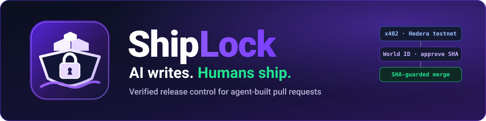
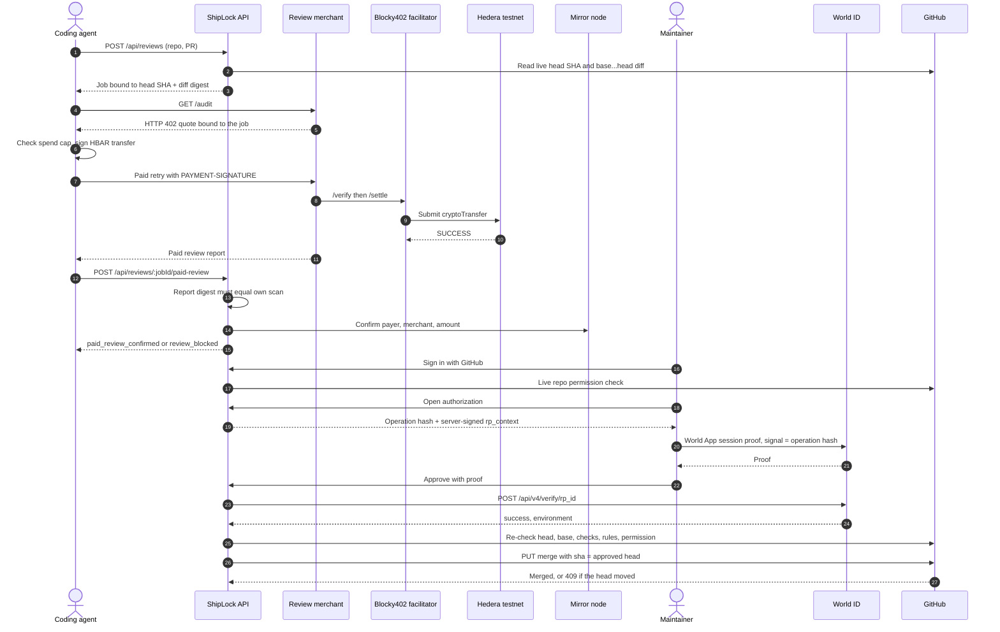

<div align="center">



<h1>ShipLock</h1>

<p><strong>AI writes. Humans ship.</strong><br/>
Agent-paid independent code review, World ID human approval, and a GitHub merge that only lands the exact commit that was reviewed and approved.</p>

<p>


</p>

<p>
<a href="https://shiplock-gamma.vercel.app"><strong>Live demo</strong></a> ·
<a href="#-live-proof"><strong>Live proof</strong></a> ·
<a href="#-how-to-use"><strong>Run it</strong></a> ·
<a href="docs/ARCHITECTURE.md"><strong>Docs</strong></a>
</p>

</div>

---

## Why

AI coding agents now open pull requests faster than humans can read them. Today the chain from "someone reviewed this" to "this is what got merged" is held together by trust. A review covers one commit, a maintainer clicks approve on a page, and the branch can move in between. Nothing binds **what was reviewed** and **what a human approved** to **what actually merges**.

ShipLock makes that binding explicit and checkable:

> **merged code == reviewed code == authorized code.** Anything else fails closed.

## How it works

1. **The agent pays for its own review.** The coding agent opens a PR and buys an independent code review over **standard x402 v2** on **Hedera testnet**. The price is a fixed HBAR amount, settled through the hosted **Blocky402** facilitator and kept within a configured spend cap. No human is involved in the payment.
2. **ShipLock checks the review.** ShipLock re-scans the exact `base...head` diff itself and requires the paid report's digest to equal its own. It then confirms the settlement on the **Hedera mirror node**: the right payer, merchant and amount.
3. **A real maintainer approves that commit.** The maintainer signs in with **GitHub** and must have live write permission on the repo. They approve with **World ID** (IDKit 4.x). This is a one-use session proof whose signal is the hash of the exact merge operation: repo, PR, head SHA, review digest, approver and expiry. ShipLock verifies it server-side with `POST /api/v4/verify/{rp_id}`.
4. **ShipLock merges only that SHA.** It re-checks permission, head, base, required checks and branch rules, then calls GitHub's merge API with the `sha` precondition.



If the head moves, the approval expires, the maintainer cancels or denies, a proof or nullifier is replayed, the report doesn't match, the payment can't be confirmed, a required check fails, or two merges race, ShipLock does not merge.

## 🔎 Live proof

These ran against real infrastructure. You can check every link yourself. The demo target is [`Hebx/shiplock-demo-target`](https://github.com/Hebx/shiplock-demo-target), a disposable repo with a ruleset that requires a PR and a passing `typecheck`, with no bypass actors.

| What happened | Hedera testnet transaction |
|---|---|
| [Demo PR #1](https://github.com/Hebx/shiplock-demo-target/pull/1), original head `d0cbdfd3…`: agent paid, report digest matched ShipLock's own, **accepted** | [`0.0.7162784@1794015688.593589740`](https://hashscan.io/testnet/transaction/0.0.7162784-1794015688-593589740) |
| [Demo PR #2](https://github.com/Hebx/shiplock-demo-target/pull/2): agent paid, review found 1 critical, 3 high and 2 medium issues, PR **blocked** | [`0.0.7162784@1794015765.601324030`](https://hashscan.io/testnet/transaction/0.0.7162784-1794015765-601324030) |
| Demo PR #1 after its head moved to `953ab250…`: old review went **stale**, the new head was re-reviewed and paid separately | [`0.0.7162784@1794016014.583132223`](https://hashscan.io/testnet/transaction/0.0.7162784-1794016014-583132223) |

For each transaction, the mirror node shows `SUCCESS`, the payer debited 1000 tinybar and the merchant credited 1000 tinybar. Payer `0.0.7304745`, merchant `0.0.9050506`, fee payer `0.0.7162784` (Blocky402). Full write-up: [Gate C payment evidence](docs/evidence/integration/gate-c-payment.md).

- **World ID 4.0, production:** a real World App enrollment was verified server-side by World ([evidence](docs/evidence/world/production-enrollment.md)). The owner's identity matched only once Selfie Check was accepted, so the credential was most likely **Selfie Check**, a lower assurance level than Orb. ShipLock does not yet record the credential type.
- **World approval + SHA-guarded merge, production:** a cancelled approval (`world_cancelled:closed`) reached no merge. Then an approval whose World proof signs operation hash `07e16707…` merged [demo PR #1](https://github.com/Hebx/shiplock-demo-target/pull/1) at exactly the reviewed and paid head `953ab250…` → squash commit [`5132381c`](https://github.com/Hebx/shiplock-demo-target/commit/5132381cd54db4a2c392014f75d02cd1a42bef74) ([evidence](docs/evidence/integration/live-approval-and-merge.md)).

### Live vs unit-tested

| Capability | Live | Unit-tested only |
|---|---|---|
| Agent buys a review via x402 on Hedera testnet; mirror-node confirmation | ✅ 3 txs above | |
| Paid report digest == ShipLock's own scan of the exact diff | ✅ demo PRs #1, #2 | |
| New commit → old paid review retired, new head re-paid | ✅ PR #1 `d0cbdfd3…` → `953ab250…` | |
| World ID production enrollment (server-verified) | ✅ | |
| Cancelled World approval → no merge | ✅ | |
| Approved exact SHA → SHA-guarded merge | ✅ `953ab250…` → `5132381c` | |
| Repo rulesets: PR + required check, no bypass | ✅ [REPO_PROTECTION](docs/evidence/github/REPO_PROTECTION.md) | |
| New commit pushed **after approval** → blocked | | ✅ `apps/api/test/merge.test.ts` |
| Expired / reused authorization, proof or nullifier replay | | ✅ `approval.test.ts`, `merge.test.ts` |
| Non-maintainer with a valid World proof | | ✅ `maintainer.test.ts` |
| Failing required check, concurrent or repeated merge | | ✅ `merge.test.ts` |
| Mismatched report, failed or unsupported payment | | ✅ `paid-review.test.ts`, `packages/x402` |

**Not claimed:** ShipLock is not the only merge path on the demo repo, since a write collaborator can merge after `typecheck` passes. The audit merchant is not publicly reachable. The World credential used was most likely Selfie Check, not Orb.

## 🚀 How to use

### Try the live demo

1. Open **https://shiplock-gamma.vercel.app** and **sign in with GitHub**.
2. **Enroll World ID** with the World App on your phone.
3. Open a **pull request review**: you see the exact head SHA, the findings, and the paid review with its HashScan link.
4. **Approve with World ID.** The proof signs the operation hash shown on screen.
5. **Merge.** ShipLock merges only the approved SHA.

> Anyone can browse reviews. Only GitHub users with write access to the allowlisted demo repo can approve and merge.

### Run locally

**Prerequisites**

- Node **22.13+** and **pnpm 10**
- A funded **Hedera testnet ECDSA** account for the agent payer, plus a different account to receive payments as the merchant
- A **World Developer Portal** app (World ID 4.0) with an RP signing key and an enrollment action
- A **GitHub OAuth App** with callback `${APP_URL}/api/auth/github/callback`
- A **fine-grained token** for one disposable repo only: Contents RW, Pull requests RW, Checks R, Commit statuses R, Metadata R

```bash
pnpm install
cp .env.example .env.local   # fill in locally; never commit it
```

Key variables in `.env.local` (see [`.env.example`](.env.example) and [docs/SETUP.md](docs/SETUP.md)):

| Group | Variables |
|---|---|
| App | `APP_URL`, `DATABASE_URL`, `SESSION_SECRET`, `API_PORT`, `SHIPLOCK_API_ORIGIN`, `SHIPLOCK_AGENT_TOKEN` |
| Hedera / x402 | `HEDERA_NETWORK`, `HEDERA_AGENT_ACCOUNT_ID`, `HEDERA_AGENT_PRIVATE_KEY`, `HEDERA_AUDIT_PAYTO_ACCOUNT_ID`, `HEDERA_MIRROR_NODE_URL`, `X402_FACILITATOR_URL`, `AUDIT_PRICE_TINYBAR`, `AGENT_MAX_PAYMENT_TINYBAR`, `SHIPLOCK_ACCEPTED_EVIDENCE` |
| World ID | `WORLD_APP_ID`, `WORLD_RP_ID`, `WORLD_RP_SIGNING_KEY`, `WORLD_ENVIRONMENT`, `WORLD_ENROLL_ACTION`, `WORLD_REQUIRE_USER_PRESENCE` |
| GitHub | `GITHUB_OAUTH_CLIENT_ID`, `GITHUB_OAUTH_CLIENT_SECRET`, `GITHUB_DEMO_REPO`, `GITHUB_FINE_GRAINED_TOKEN`, `SHIPLOCK_MIN_GITHUB_PERMISSION`, `SHIPLOCK_MERGE_METHOD` |

Start each in its own terminal:

```bash
pnpm --filter @shiplock/api start        # ShipLock API on :4000
pnpm --filter @shiplock/web dev          # Web UI on :3000
pnpm --filter @shiplock/agent merchant   # x402 review merchant on :4402
```

Then let the agent buy a review for a PR in your allowlisted repo:

```bash
pnpm --filter @shiplock/agent review owner/repo#1
```

The agent binds a job to the PR's current head and pays within `AGENT_MAX_PAYMENT_TINYBAR`. It submits the paid report and prints the outcome (`accepted` exits 0). Its payment ledger means it never pays twice for a job. Then open `http://localhost:3000`, sign in, enroll, and approve.

`WORLD_ENVIRONMENT=staging` uses the World ID Simulator. Those are **development proofs, not real human verification**, and the UI labels them that way. Staging proofs cannot drive a real merge unless `SHIPLOCK_ALLOW_DEVELOPMENT_MERGE=true` is set for a demo repo. Integrations without configuration return HTTP 503; they never fake success.

### Tests

```bash
pnpm -r typecheck
pnpm -r test   # 193 unit tests across 7 packages
```

The unit tests stub World, GitHub and the mirror node. They cover every negative path in the [security matrix](docs/SECURITY.md#negative-test-matrix), but they are not live evidence. Live evidence lives under [`docs/evidence/`](docs/evidence/).

## 🛡️ Security model

- **Exact bytes.** Reviews bind repo ID, PR, head SHA, base SHA and scanner version. A moved head turns old reviews and approvals `stale`.
- **Independent digest.** A paid report is accepted only if its digest equals ShipLock's own scan of the same diff, and ShipLock confirms the settlement on the mirror node itself. The quote is never repriced on retry, and a payment with an uncertain outcome is never re-sent.
- **Identity and authority are separate.** GitHub says who the maintainer is, and live repo permission says whether they may merge. World ID only proves a unique human is present. A client-side `success: true` or widget `onSuccess` is ignored.
- **One-use approval.** Each approval uses a single-use RP nonce, the session proof must come from the enrolled World session, and every nullifier is accepted only once. The approval expires after 10 minutes and is consumed before the GitHub call.
- **SHA-guarded merge.** The merge request carries GitHub's `sha` precondition. If the outcome is unknown, ShipLock reconciles by reading the PR and never retries the merge.
- **Reviewed by a second agent.** Hermes reviewed the approval, session and merge gate adversarially and found **0 critical, 0 high, and 4 medium issues, all fixed** ([review](docs/reviews/hermes-security-review-cursor-product-gate.md)).

**Honest limits:** the scanner uses deterministic heuristics and is **not a security certification**. GitHub rulesets still let maintainers with direct access merge outside ShipLock; making ShipLock a required status check is the path to closing that. The buyer and the merchant are run by the same team in this demo. Full invariants: [docs/SECURITY.md](docs/SECURITY.md).

## Repo layout

| Path | What it does |
|---|---|
| [`apps/web`](apps/web) | Next.js 16 UI: pull requests, review detail, human checkpoint (IDKit widgets), maintainer page |
| [`apps/api`](apps/api) | Hono + SQLite API: review jobs, GitHub sessions, World enrollment and approval, paid-review acceptance, merge executor |
| [`apps/agent`](apps/agent) | Autonomous review buyer (`review`) and x402 audit merchant (`merchant`) |
| [`packages/shared`](packages/shared) | Contracts, Zod schemas, canonical JSON + SHA-256, release state machine |
| [`packages/scanner`](packages/scanner) | Deterministic diff scanner that never executes PR code |
| [`packages/github`](packages/github) | Allowlisted GitHub client: snapshot, compare, permissions, checks, rules, SHA-guarded merge |
| [`packages/policy`](packages/policy) | Paid-review verification and the canonical merge operation hash (`shiplock.merge-operation/v2`) |
| [`packages/x402`](packages/x402) | Hedera x402 buyer, merchant and mirror-node client |

**Tech stack:** TypeScript 7, Next.js 16, React 19, Tailwind 4, Hono 4, `node:sqlite`, `@x402/core` 2.30, `@hiero-ledger/sdk` 2.90, `@worldcoin/idkit` 4.6, Zod 4, Vitest 5, pnpm workspaces.

**Further reading:** [Architecture](docs/ARCHITECTURE.md) · [Security](docs/SECURITY.md) · [Integration contract](docs/INTEGRATION_CONTRACT.md) · [Setup](docs/SETUP.md) · [Demo script](docs/DEMO.md) · [Progress](docs/PROGRESS.md)

## Credits

Built for **ETHGlobal Mumbai 2026** by [Hebx](https://github.com/Hebx), with two AI coding agents: **Cursor** built the app and integration, and **Hermes** handled payments, research and the security review. ShipLock practices what it preaches: agents write the code, humans ship it.
