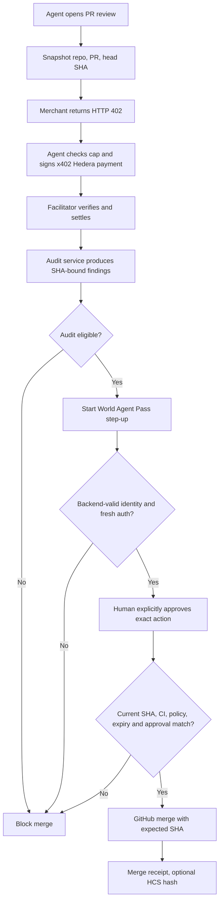

# Architecture — planned, not implemented

## Actors and trust boundaries

- **Agent buyer:** independently decides an audit is required, has narrow Hedera testnet spending credentials and maximum price. Cannot create approvals or merge PRs directly.
- **Audit merchant:** public x402-protected API that inspects GitHub diff **at a fixed SHA** and returns structured deterministic findings. Separate signing/merchant role.
- **Facilitator:** trusted-to-verify/settle x402 against Hedera testnet; do not bypass with direct transfers or mocks.
- **ShipLock server:** owns DB, World OIDC code exchange, audit/approval policy, GitHub merge credential, and immutable action hash.
- **World OIDC:** authenticates a human under requested freshness and assurance; does **not** itself grant merge authority.
- **GitHub:** canonical PR head, checks, branch rules and merge API enforcing expected SHA.
- **HCS (optional):** hashes and references only, no code snippets, ID tokens, or personal identifiers.

## Flow

## API contract, planned

- `POST /api/reviews`: create intent only for allowlisted repo, store repo/PR/head SHA, audit quote resource and price.
- `GET /api/reviews/:reviewId`: read status and sanitized evidence.
- `GET /api/audits/:reviewId`: unpaid returns standards-conforming HTTP 402; paid retry verifies/settles with facilitator, idempotently delivers signed/digested findings for exact SHA.
- `POST /api/approvals/:reviewId/start`: new World OIDC step-up attempt tied to immutable operation hash, session, role and expiry.
- `GET /api/auth/world/callback`: one-time code redemption/ID-token validation and attempt transition (not automatic merge consent).
- `POST /api/approvals/:reviewId/confirm`: explicit approval, one-use, current exact action hash.
- `POST /api/reviews/:reviewId/merge`: re-fetch PR SHA, require audit passing, check statuses, approval and policy, consume grant atomically, call GitHub merge with `sha`.

## Suggested DB tables

`review_intents(id, repo, pr, head_sha, rules_version, status, quote_hash, audit_digest, tx_id, created_at)`
`payment_receipts(tx_id UNIQUE, review_id, asset, amount, payee, verified_at, fulfilled_at, state)`
`world_attempts(id, review_id, action_hash, initiating_session, oidc_state_hash, nonce_hash, pkce_ref, expected_iss, expected_sub, status, expiry, auth_time)`
`merge_approvals(id, review_id, action_hash UNIQUE, authorized_world_iss, authorized_world_sub, expiry, consumed_at, status)`
`merge_attempts(review_id UNIQUE, expected_sha, result, github_url, created_at)`
`audit_events(id, time, type, payload_digest)`

## Canonical action payload

Canonical JSON serialization with explicit ordered/typed fields: `{action:'merge_pr', repoId, repoFullName, prNumber, baseRef, headSha, auditDigest, auditRulesVersion, approverAccountId, expiresAt, nonce}`; hash once and store before OIDC. Rehash before execution. Never accept changed callback/body fields as the authority.

## State machine

`CREATED -> 402_REQUIRED -> PAID -> REVIEWED -> WORLD_PENDING -> WORLD_VALIDATED -> AWAITING_CONSENT -> APPROVED -> MERGING -> MERGED`

Terminal/guarded outcomes: `PAYMENT_FAILED`, `AUDIT_BLOCKED`, `WORLD_DENIED`, `WORLD_CANCELLED`, `WORLD_EXPIRED`, `IDENTITY_MISMATCH`, `STALE_SHA`, `APPROVAL_REPLAY`, `GITHUB_REJECTED`. Treat uncertain payment/merge result as reconciliation-needed, **not** permission to blindly retry a side effect.

## Assurance and limitations

Until installed as required GitHub status check / protected branch policy, the app's merge button only guards operations run **through this app**; other actors with GitHub permissions may bypass it. A paid independent endpoint does not prove vendor independence if the same team controls buyer and merchant. Distinguish real settled testnet payments, World test identities and simulated failure fixtures.
