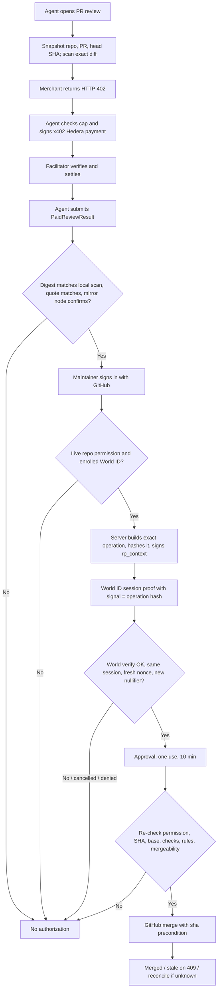

# Architecture

Implemented and unit-tested on `cursor/product-gate`; not yet run against live World, GitHub OAuth or a real merge. The x402 payment path is Hermes's (`packages/x402`, `hermes/hedera-x402`). See `docs/PROGRESS.md` for verified status.

## Actors and trust boundaries

- **Agent buyer:** independently decides an audit is required, has narrow Hedera testnet spending credentials and maximum price. Cannot create approvals or merge PRs directly.
- **Audit merchant:** public x402-protected API that inspects GitHub diff **at a fixed SHA** and returns structured deterministic findings. Separate signing/merchant role.
- **Facilitator:** trusted-to-verify/settle x402 against Hedera testnet; do not bypass with direct transfers or mocks.
- **ShipLock server:** owns the DB, GitHub sign-in sessions, World RP signing key and proof verification, audit/approval policy, the GitHub merge credential, and the immutable operation hash.
- **GitHub (identity):** OAuth App sign-in establishes *which* maintainer is acting; live collaborator permission establishes whether they may merge.
- **World ID (IDKit):** proves a unique human is present (Proof of Human, with a fresh user-presence check where supported). It does **not** identify the maintainer or grant merge authority on its own.
- **Hedera mirror node:** independent confirmation that the paid-review transaction settled as quoted.
- **GitHub (repository):** canonical PR head, checks, branch rules and merge API enforcing expected SHA.
- **HCS (optional):** hashes and references only, no code snippets, tokens or personal identifiers.

## Flow

## API

Agent (bearer `SHIPLOCK_AGENT_TOKEN`):

- `POST /api/reviews {repository, pullNumber}` — bind a job to the live head SHA and scan the exact base...head diff.
- `POST /api/reviews/:jobId/paid-review {adapterId, result}` — submit a `PaidReviewResult`; 200 accepted, 202 ledger pending, 422 rejected.

Read-only:

- `GET /api/pull-requests`, `GET /api/reviews/:jobId` — jobs, findings, paid review (HashScan link only for live, mirror-confirmed evidence), authorization, merge attempt, events.

Maintainer (session cookie; mutations need `x-csrf-token`):

- `GET /api/auth/github/start`, `GET /api/auth/github/callback`, `GET /api/session`, `POST /api/auth/logout`.
- `POST /api/world/enrollment/start`, `POST /api/world/enrollment/complete {requestId, idkitResult}`.
- `POST /api/authorizations {jobId}` — build the operation from server state, open a 10-minute authorization, return the World request (`rp_context`, `existing_session_id`, `signal` = operation hash).
- `POST /api/authorizations/:id/proof-request` — fresh `rp_context` for the same pending authorization.
- `POST /api/authorizations/:id/approve {requestId, operationHash, idkitResult}`.
- `POST /api/authorizations/:id/deny {reason?}`, `POST /api/authorizations/:id/cancel {errorCode?}`.
- `POST /api/merges/:authorizationId/execute`, `POST /api/merges/:authorizationId/reconcile`.

Unconfigured integrations (GitHub OAuth, World, paid review, agent token) return HTTP 503.

## Data model (SQLite, `apps/api/src/db/migrations`)

- `repositories`, `pull_requests`, `review_jobs` (state machine in `packages/shared/src/state.ts`), `findings`, `audit_events`.
- `payment_receipts(hedera_transaction_id UNIQUE, review_job_id UNIQUE, …, evidence_kind, report_sha256, ledger_verified_at)`.
- `github_oauth_states(state_hash, browser_hash, expires_at, consumed_at)`; `sessions(id_hash, csrf_token_hash, github_user_id, github_login, expires_at, revoked_at)`.
- `world_enrollments(github_user_id UNIQUE, session_id UNIQUE, UNIQUE(environment, rp_id, enroll_action, nullifier))`.
- `world_proof_requests(rp_nonce UNIQUE, purpose, session_id_hash, github_user_id, authorization_id, expected_signal, status, expires_at)`.
- `world_session_nullifiers(nullifier PRIMARY KEY)`.
- `merge_authorizations(operation_json, operation_hash, github_user_id, world_enrollment_id, world_environment, session_id_hash, status, expires_at, approved_at, consumed_at)`; at most one open per job.
- `merge_attempts(authorization_id UNIQUE, expected_sha, status, github_http_status, merge_commit_sha, merge_url)`.

Migration `002` retires the Agent Pass tables; any pending/approved Agent Pass authorization is invalidated.

## Canonical operation

`shiplock.merge-operation/v2` (`packages/policy`): `{action, authorizationId, repositoryId, repository, pullNumber, headSha, baseRef, reportSha256, scannerVersion, paidReviewEvidenceKind, mergeMethod, approverGithubLogin, approverGithubUserId, worldEnvironment, worldRpId, nonce, expiresAt}` → canonical JSON → SHA-256. Hashed and stored before the World request; re-validated and re-hashed before approval and before execution. Request bodies never supply operation fields.

## State machine

`discovered → review_pending → paid_review_confirmed → approval_pending → approved → merge_in_progress → merged`

Guarded outcomes: `review_blocked`, `denied`, `expired`, `stale`, `invalid`, `failed`, `reconcile_required`. A blocked pre-merge check returns the job to `paid_review_confirmed` (the approval is consumed; a fresh one is required). An uncertain merge result is reconciled by reading the PR, never by retrying the merge.

## Assurance and limitations

Until installed as required GitHub status check / protected branch policy, the app's merge button only guards operations run **through this app**; other actors with GitHub permissions may bypass it. A paid independent endpoint does not prove vendor independence if the same team controls buyer and merchant. Distinguish real settled testnet payments, World staging (simulator) proofs and simulated fixtures.
